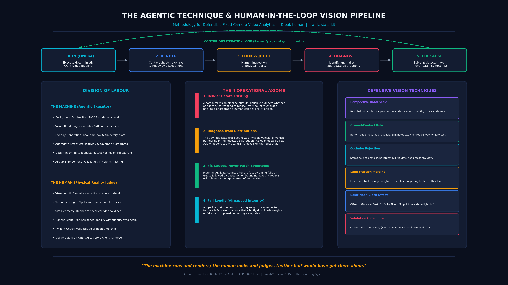

# traffic-stats-kit (cctv-traffic-count)

[](https://github.com/dipak1020/traffic-stats-kit/actions)
[](LICENSE)
[](LICENSE-DOCS)
[](#)
[](#)

Turn fixed-camera CCTV and DVR footage into an auditable, civil-engineering-grade traffic survey: per-vehicle timeline, directionality, vehicle classification, hourly volume, headway distribution, occupancy, and a photograph of every counted vehicle. **Runs entirely offline on CPU with zero network calls and zero telemetry leaks.**

Field-tested on over 170 hours of continuous roadside Hikvision DVR footage (**11,693 vehicles over 8 days**, six with complete 24-hour coverage), engineered as a camera-agnostic, offline framework.


```
ffmpeg  →  OpenCV background subtraction  →  tracking  →  optional YOLO  →  PDF / DOCX / CSV
```

---

## Architecture & Agent Technique Map

The complete system pipeline—from video acquisition and 1D virtual inductance loop sampling to spatial tracking, multi-headway thresholding, and multi-agent coordination:



*For interactive publication-grade derivations with KaTeX rendering, see [`docs/METHODOLOGY.html`](docs/METHODOLOGY.html) and [`docs/APPROACH.md`](docs/APPROACH.md).*

---

## Mathematical Formulations & Computer Vision Method

`traffic-stats-kit` rejects non-deterministic black-box detectors in favor of verified physical signal processing and geometric constraints:

### 1. Perspective-Invariant Road Corridor & Optical Scale
Given upper pavement boundary $\mathcal{P}_{\text{far}}$ and lower pavement boundary $\mathcal{P}_{\text{near}}$, the local optical band height $H(x)$ scales all spatial parameters:

$$H(x) = y_{\text{near}}(x) - y_{\text{far}}(x)$$

All spatial metrics (bounding box tolerances, kernel sizes, inter-blob clearances) are normalized against $H(x)$, ensuring distance invariance across oblique camera angles.

### 2. Temporal Median Asphalt Background Estimation
For a temporal frame sample $\mathcal{S} = \{t_1, t_2, \dots, t_N\}$, the static pavement model $\mathcal{B}(x, y)$ and foreground luminance delta $\mathcal{D}(x, y, t)$ are given by:

$$\mathcal{B}(x, y) = \text{median}_{t \in \mathcal{S}} \Big\{ \mathcal{I}(x, y, t) \Big\}$$

$$\mathcal{D}(x, y, t) = \big| \mathcal{I}(x, y, t) - \mathcal{B}(x, y) \big|$$

Foreground activation binary mask:

$$\mathcal{M}(x, y, t) = \begin{cases} 1, & \mathcal{D}(x, y, t) \ge \tau_{\text{thresh}} \\ 0, & \mathcal{D}(x, y, t) < \tau_{\text{thresh}} \end{cases}$$

### 3. Chronological Two-Line Verification Protocol
To eliminate false counts from branch oscillations, shadow flicker, and stationary reflections:

$$\text{Pass}_{\text{valid}} \iff \exists \, t_1, t_2 \quad \text{such that} \quad x(t_1) = x_{\text{count}}, \; x(t_2) = x_{\text{verify}}, \; t_2 > t_1$$

The travel direction is signed by trajectory displacement:

$$\text{Direction} = \text{sgn}\big(x(t_2) - x(t_1)\big) = \begin{cases} \text{Left-to-Right (LR)}, & x(t_2) > x(t_1) \\ \text{Right-to-Left (RL)}, & x(t_2) < x(t_1) \end{cases}$$

### 4. Scale-Normalized In-Frame Articulated Vehicle Merging
Articulated semi-trailers have a visual gap above the fifth wheel where asphalt shows through. We merge blobs sharing wheel-line grade contact within scale-normalized tolerances:

$$\Delta x_{\text{gap}} = |x_1 - x_2| - \frac{w_1 + w_2}{2} \le 0.45 \cdot H(x)$$

$$\Delta y_{\text{contact}} = |y_{1,\text{ground}} - y_{2,\text{ground}}| \le 0.15 \cdot H(x)$$

### 5. Traffic Flow Parameters (HCM Standards)
* **Time Headway:** $h_i = t_i - t_{i-1}$ (Enforced Floor: $h_i \ge 1.0\,\text{s}$)
* **Peak Hour Factor (PHF):**
  $$\text{PHF} = \frac{V_{\text{hour}}}{4 \times V_{15,\max}}$$
* **Time Occupancy Rate:**
  $$\rho_{\text{occ}} = \frac{\sum_{i=1}^N \Delta t_{\text{occupancy}, i}}{T_{\text{period}}} \times 100\%$$

### 6. Astronomical Solar Noon RTC Clock Recovery
Roadside DVR internal clocks frequently drift. The true astronomical time offset is recovered from dawn and dusk luminance transitions:

$$t_{\text{midpoint}} = \frac{t_{\text{dawn}} + t_{\text{dusk}}}{2}$$

$$\Delta t_{\text{RTC}} = t_{\text{midpoint}} - t_{\text{solar\_noon}}(\phi, \lambda, \text{date})$$


---

## Agentic AI Multi-Agent Framework

This repository is designed from the ground up for collaborative human and autonomous AI agent development. Whether you operate via **Gemini CLI**, **Claude Code**, **Antigravity**, or **Codex**, the agent reads dedicated operational constraints and enforcement hooks:

| Configuration / Agent File | Target Agent / Tool | Purpose |
|---|---|---|
| [`GEMINI.md`](GEMINI.md) | Gemini CLI / Google AI | High-level architectural checks, SOP compliance, visual QA of contact sheets |
| [`AGENTS.md`](AGENTS.md) | Antigravity / Codex | Multi-agent rules, edge execution boundaries, pipeline test execution |
| [`CLAUDE.md`](CLAUDE.md) | Claude Code | Context configuration linking directly to skills and hooks |
| `.agents/skills/traffic-stats/` | Antigravity & Gemini CLI | Native agent skill definition for traffic survey generation |
| `.claude/skills/traffic-stats/` | Claude Code | Direct skill invocation for automated traffic estimation |
| `.claude/hooks/` | Local Enforcers | Pre- and post-tool execution guard rails (`no_network.py`, `calibration_guard.py`, `gate_reminder.py`) |

---

## The Unified Orchestrator CLI

The `traffic_stats.orchestrator` module provides an end-to-end command-line interface for human engineers and autonomous agents:

```bash
# 1. Environment and dependency audit (Python >= 3.10, ffmpeg, OpenCV, ruff, pytest)
python -m traffic_stats check

# 2. Self-scoring synthetic benchmark with articulated vehicle de-duplication
python -m traffic_stats demo --minutes 5 --headway 20 --out out

# 3. Calibrate a new CCTV camera site (extracts median asphalt & renders diagnostic overlay)
python -m traffic_stats calibrate --video path/to/sample.mp4 --out out/diagnostics

# 4. Batch process a folder of real video clips offline on CPU
python -m traffic_stats run --videos /path/to/clips --out out/survey

# 5. Audit an existing timeline CSV against the 4 engineering validation gates
python -m traffic_stats audit --timeline out/timeline.csv

# 6. Install git verification pre-commit hooks and agentic guard rails
python -m traffic_stats install-hooks
```

---

## Quick Start

### 1. Installation

```bash
# Install system ffmpeg (required for frame decoding)
brew install ffmpeg python@3.12       # macOS
# sudo apt-get install ffmpeg python3-venv  # Ubuntu/Debian

# Clone repository and create local environment
git clone https://github.com/dipak1020/traffic-stats-kit.git
cd traffic-stats-kit
python3 -m venv .venv && source .venv/bin/activate

# Install package in editable mode with development tools
pip install -e ".[dev]"
```

### 2. Verify System Health

```bash
python -m traffic_stats check
```

---

## What Comes Out

| Output File | Engineering Contents |
|---|---|
| `timeline.csv` | One row per counted vehicle: timestamp, direction (`LR`/`RL`), normalized width, vehicle class, image path |
| `buckets.csv` | Per hour: directional volume split, cumulative totals, % of daily traffic, mean headway, Peak Hour Factor (PHF) |
| `contact_sheet.png` | **GATE 1:** Visual grid of every vehicle counted—mandatory visual inspection artifact |
| `audit_report.json` | Numerical validation verdicts for headway distributions and coverage continuity |
| `crops/` | Full-resolution photograph of every counted vehicle with timestamp watermark |

---

## The 4 Non-Negotiable Engineering Validation Gates

A pipeline reports numbers whether or not they mean anything. The 4 gates decide if the results are valid before any number is published:

1.  **Contact Sheet Visual Audit:** Every tile on `contact_sheet.png` must show a genuine vehicle. No numeric metric replaces looking.
2.  **Headway Gate ($< 1.0\,\text{s}$ Floor):** Two physical vehicles cannot be 8 m apart at 60 km/h. A spike under 1.0 s signals that an articulated truck was split into cab and trailer. Merging must occur in-frame.
3.  **Coverage Gate ($> 95\%$):** A peak hour over a day missing its afternoon is not a peak hour. Gaps must be accounted for and labeled as 'peak of available data'.
4.  **Determinism Gate:** Identical input footage processed twice must yield bit-exact CSV timeline rows.

---

## Real-World Problems Solved

1.  **Occlusion Artifacts (Poles and Fences):** Vehicles extend *upward* from the road surface. Growing the detection zone upward from the asphalt polyline and verifying ground contact filters out camera vibrations and tree canopies. Occluder columns are recorded from the median background, and the largest *clear* view is retained.
2.  **Articulated Truck Splitting:** The visual gap between a tractor cab and a semi-trailer frequently splits the vehicle into two blobs. In-frame merging groups bounding boxes that share ground-line contact and fall within scale-normalized headway tolerances (0.45 band-heights).
3.  **Two-Line Verification:** A valid pass requires crossing `count_x` AND `verify_x`. Stationary artifacts, wire shadows, and glare oscillating across a single line are rejected.
4.  **Day/Night Transition:** Day uses a compact morphological kernel (0.18 x 0.13 band-heights); night switches to an elongated horizontal kernel (0.49 x 0.18 band-heights) to bridge twin headlights into a single vehicle entity.
5.  **DVR Clock Recovery:** If the recorder clock drifted, the true clock offset is derived from the solar noon midpoint: $\text{offset} = \frac{\text{dawn} + \text{dusk}}{2} - \text{solar\_noon}(\text{lat}, \text{lon}, \text{date})$.

---

## Documentation Index

*   [`docs/APPROACH.md`](docs/APPROACH.md) — Comprehensive guide to the generic method and stage-by-stage engineering rationale.
*   [`docs/CALIBRATION.md`](docs/CALIBRATION.md) — How to calibrate road polylines, band height, occluders, and counting lines for a new camera.
*   [`docs/DESIGN.md`](docs/DESIGN.md) — Design principles and architectural trade-offs.
*   [`docs/PORTABILITY.md`](docs/PORTABILITY.md) — Porting instructions for macOS, Linux, and embedded low-power edge units.
*   [`docs/PRACTICE_DATA.md`](docs/PRACTICE_DATA.md) — Public CCTV video sources for practice and model calibration.

---

## Licence

*   **Code** (`traffic_stats/`, `pipeline/`, `.claude/hooks/`): [MIT License](LICENSE). Copyright (c) 2026 Dipak Kumar.
*   **Documentation, diagrams, skills, and examples** (`docs/`, `examples/`, `README.md`, `.claude/skills/`, `.agents/skills/`): Creative Commons Attribution 4.0 International ([CC BY 4.0](https://creativecommons.org/licenses/by/4.0/)). See [`LICENSE-DOCS`](LICENSE-DOCS).

---

## Author & Attribution

**Dipak Kumar**  
Computational Modeling & Simulation Specialist  
Asunción, Paraguay  
GitHub: [@dipak1020](https://github.com/dipak1020)
