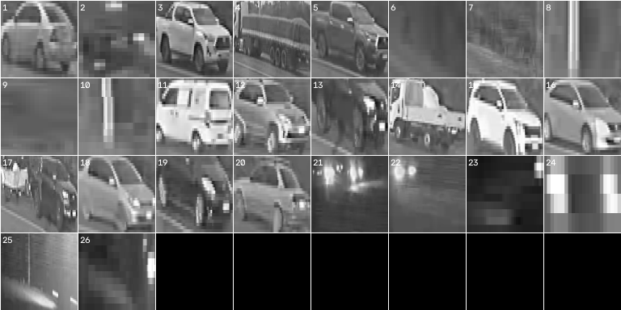
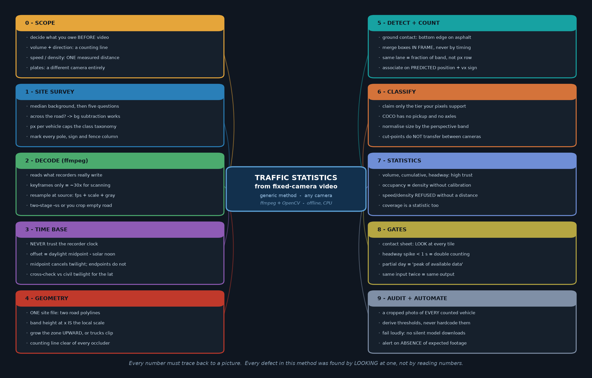

<div align="center">

# 🚦 traffic-stats-kit

### First Principles in Traffic Video Analytics: A Deterministic Engineering Approach to Roadway Monitoring

[](#)
[](#)
[](LICENSE)
[](LICENSE-DOCS)
[](#)
[](#)
[](https://drive.google.com/drive/folders/19WZarf0nnM5d9DlePg2Dy0LOZM7RJs-p?usp=share_link)

**[📖 Interactive Methodology Paper](docs/METHODOLOGY.html)** • **[📰 Long-form Engineering Essay](docs/ARTICLE.html)** • **[💼 LinkedIn Article](docs/LINKEDIN_ARTICLE.md)** • **[📁 Real Video Dataset](https://drive.google.com/drive/folders/19WZarf0nnM5d9DlePg2Dy0LOZM7RJs-p?usp=share_link)**

---

</div>

Turn fixed-camera CCTV and roadside DVR footage into an auditable, civil-engineering-grade traffic survey: per-vehicle timeline, travel directionality, vehicle classification, hourly volume buckets, headway distributions, lane occupancy, and an automated visual contact sheet showing every counted vehicle.

> **Runs 100% offline on standard multi-core CPUs (<12W) using deterministic OpenCV and NumPy. Zero cloud dependencies, zero external GPUs, and zero telemetry leaks.**

Field-validated over **170+ hours of continuous roadside Hikvision DVR recordings (11,693 vehicles over 8 days)** in the Villeta industrial corridor, Paraguay.

```
Raw CCTV Stream  ──►  1D Virtual Loops  ──►  Temporal Median Asphalt  ──►  Two-Line Turnstile  ──►  Visual Proof & CSVs
```

---

## 📸 Visual Integrity: Gate 1 Contact Sheet

In civil engineering, an unverified number is worse than no number at all. Every survey run automatically produces a tiled photographic matrix of every vehicle counted:

<div align="center">



*Figure: Automated Visual Contact Sheet generated directly from 4 real Camera A27 DVR excerpts (Villeta, Paraguay). Human reviewers can visually audit 500 vehicle crossings in under 30 seconds.*

</div>

---

## 🏛️ System Architecture

The pipeline couples geometric perspective normalization with physical ground-contact rules and multi-agent coordination:

<div align="center">



</div>

---

## 📐 Mathematical Foundations & First Principles

`traffic-stats-kit` rejects opaque black boxes in favor of geometric discipline and physical constraints:

### 1. Perspective-Invariant Road Corridor & Optical Scale
Given upper horizon boundary $\mathcal{P}_{\text{far}}$ and lower curb boundary $\mathcal{P}_{\text{near}}$, the local optical band height $H(x)$ serves as the scene's self-calibrating physical ruler:

$$H(x) = y_{\text{near}}(x) - y_{\text{far}}(x)$$

Every spatial threshold (bounding box tolerances, morphological kernels, coupling clearances) scales as a dimensionless fraction of $H(x)$:

$$\text{Tolerance}_{\text{normalized}}(x) = \gamma \cdot H(x)$$

### 2. Temporal Median Asphalt Baseline
Rather than hoping to catch an empty road by chance, the pristine asphalt reference $\mathcal{B}(x, y)$ is extracted directly from active traffic using the statistical temporal median across uniformly sampled frames $\mathcal{S}$:

$$\mathcal{B}(x, y) = \text{median}_{t \in \mathcal{S}} \left\{ \mathcal{I}(x, y, t) \right\}$$

$$\mathcal{D}(x, y, t) = \left| \mathcal{I}(x, y, t) - \mathcal{B}(x, y) \right|$$

$$\mathcal{M}(x, y, t) = \begin{cases} 1, & \mathcal{D}(x, y, t) \ge \tau_{\text{thresh}} \\ 0, & \mathcal{D}(x, y, t) < \tau_{\text{thresh}} \end{cases}$$

### 3. Chronological Two-Line Turnstile Gate
A single tripwire triggers on tree shadows, swaying wires, and headlight reflections. We enforce chronological dual-line passage verification:

$$\text{Pass}_{\text{valid}} \iff \exists \, (t_1 < t_2) : \quad x(t_1) = x_{\text{count}} \;\;\land\;\; x(t_2) = x_{\text{verify}}$$

$$\text{Direction} = \text{sgn}\left(x(t_2) - x(t_1)\right) = \begin{cases} \text{Left-to-Right (LR)}, & x(t_2) > x(t_1) \\ \text{Right-to-Left (RL)}, & x(t_2) < x(t_1) \end{cases}$$

### 4. Scale-Normalized In-Frame Articulated Coupling
Tractor-trailers frequently split into two blobs because asphalt shows through above the fifth wheel. We couple adjacent blobs in-frame sharing tire-contact grade:

$$\Delta x_{\text{gap}} = |x_1 - x_2| - \frac{w_1 + w_2}{2} \le 0.45 \cdot H(x)$$

$$\Delta y_{\text{contact}} = |y_{1,\text{ground}} - y_{2,\text{ground}}| \le 0.15 \cdot H(x)$$

### 5. Traffic Flow Parameters (HCM Standards)
* **Time Headway:** $h_i = t_i - t_{i-1}$ (Automated double-count flag floor: $h_i < 1.0\,\text{s}$)
* **Peak Hour Factor (PHF):**

  $$\text{PHF} = \frac{V_{\text{hour}}}{4 \times V_{15,\max}}$$

* **Spatial Occupancy Ratio:**

  $$\rho_{\text{occ}} = \frac{\sum_{i=1}^N \Delta t_{\text{occupancy}, i}}{T_{\text{period}}} \times 100\%$$

### 6. Astronomical Solar Noon RTC Clock Recovery
Roadside DVR internal clocks drift substantially. The astronomical time offset is recovered from true solar noon:

$$t_{\text{midpoint}} = \frac{t_{\text{dawn}} + t_{\text{dusk}}}{2}$$

$$\Delta t_{\text{RTC}} = t_{\text{midpoint}} - t_{\text{solar-noon}}(\phi, \lambda, \text{date})$$

---

## 🛡️ The 4 Non-Negotiable Engineering Validation Gates

| Gate | Engineering Criterion | Safety & Integrity Purpose |
| :--- | :--- | :--- |
| **1. Visual Audit** | 100% of tiles on `contact_sheet.png` | Human reviewer inspects photograph of every counted vehicle |
| **2. Headway Floor** | $h_i < 1.0\,\text{s}$ must be $\le 5\%$ of volume | Flags unmerged tractor-trailer combinations and shadow splits |
| **3. Coverage Continuity** | Valid recorded footage $> 95\%$ | Prevents partial-day peaks from corrupting capacity baselines |
| **4. Bit Determinism** | Exact byte-for-byte CSV row matching | Guarantees mathematical reproducibility across hardware |

---

## 🚀 Quick Start (Mac & Linux)

### 1. Prerequisites & Installation

```bash
# System dependencies (macOS)
brew install ffmpeg python@3.12

# Clone the repository
git clone https://github.com/dipak1020/traffic-stats-kit.git
cd traffic-stats-kit

# Set up virtual environment
python3 -m venv .venv && source .venv/bin/activate
pip install -e ".[dev]"
```

### 2. Run with One Command

```bash
bash run_on_mac.sh
```

### 3. Step-by-Step Execution

```bash
# A. Synthetic self-scoring benchmark (in memory, no ffmpeg required)
python -m traffic_stats.demo --minutes 5 --headway 20

# B. Process the calibrated benchmark clips
python -m traffic_stats.report --videos samples --out out_benchmark --bucket 60

# C. Process REAL field CCTV footage (Camera A27 calibration)
python -m traffic_stats.report --site villeta-a27 --videos samples_real --out out_real --bucket 60

# D. Render visual diagnostic overlays (geometry, asphalt luma, artifacts)
python -m traffic_stats.overlay --site villeta-a27 --video samples_real/A27_20260831193236.mp4 --out out_real/diagnostics
```

---

## 📂 Deliverables & Output Schema

| File Name | Engineering Purpose | Format |
| :--- | :--- | :--- |
| `contact_sheet.png` | **Visual Audit Matrix:** Tiled image of every vehicle crop | PNG image |
| `timeline.csv` | **Microscopic Log:** Timestamp, direction, normalized width, velocity | CSV table |
| `buckets.csv` | **Macroscopic Volumes:** Hourly traffic volume, direction split, PHF | CSV table |
| `gates.txt` | **Integrity Report:** Poisson headway distribution, coverage continuity | Plain text |
| `diagnostics/` | Roadway band geometry, median background, day/night asphalt luma | PNG directory |

---

## 🤖 Multi-Agent Framework Integration

`traffic-stats-kit` natively supports autonomous AI workflows:

| Agent / Interface | Configuration File | Operational Role |
| :--- | :--- | :--- |
| **Gemini CLI** | [`GEMINI.md`](GEMINI.md) | High-level architectural validation and contact sheet visual QA |
| **Antigravity / Codex** | [`AGENTS.md`](AGENTS.md) | Pipeline test execution, edge performance, and multi-agent loops |
| **Claude Code** | [`CLAUDE.md`](CLAUDE.md) | Direct tool invocation and custom skill execution |
| **Pre-commit Hooks** | `.claude/hooks/` | Local guards (`no_network.py`, `calibration_guard.py`) |

---

## 📜 Licence

* **Code:** [MIT License](LICENSE). Copyright &copy; 2026 Dipak Kumar.
* **Documentation & Diagrams:** Creative Commons Attribution 4.0 International ([CC BY 4.0](LICENSE-DOCS)).

---

## 👤 Author & Attribution

**Dipak Kumar**  
Computational Modeling & Simulation Specialist  
Asunción, Paraguay  
GitHub: [@dipak1020](https://github.com/dipak1020) • Repository: [traffic-stats-kit](https://github.com/dipak1020/traffic-stats-kit)
